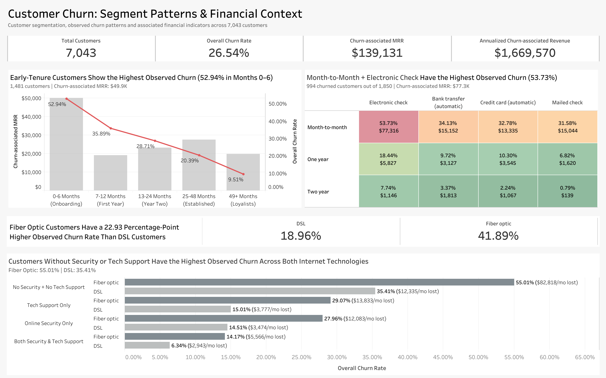

# Telco Customer Churn Analytics

An end-to-end data analytics and machine learning project exploring customer churn across 7,043 telecommunications customer records. The project combines Python data ingestion and profiling, SQL transformations with dbt, business analysis, Tableau reporting, retrospective churn classification, and SHAP model explainability.

**Tech stack:** Python 3.12 · Pandas · SQLite · SQL · dbt Core · scikit-learn · SHAP · Matplotlib · Tableau

> **Modelling scope:** The source is a customer snapshot with a recorded churn label. The machine-learning task is retrospective classification of that recorded outcome. The model has not been validated to predict churn over a future period such as the next 30 days.

## Dashboard Preview



## Project overview

The project has two main objectives:

1. **Business analytics:** describe observed churn patterns across customer, contract, billing, tenure, and service segments, and prepare analysis-ready datasets for BI reporting.
2. **Machine learning:** train and evaluate a classifier for the recorded churn outcome, explain model predictions, and prepare a reusable scoring interface for compatible customer data.

## Dataset

The project uses the [Telco Customer Churn dataset on Kaggle](https://www.kaggle.com/datasets/blastchar/telco-customer-churn), downloaded during the ingestion stage using `kagglehub`.

The dataset contains **7,043 customer records and 21 original columns**.

- Target: `Churn`, represented in the transformed data as `churn_flag`.
- `churn_flag = 1`: the recorded customer outcome is churn.
- `churn_flag = 0`: the recorded customer outcome is not churn.
- Churned customers: **1,869**.
- Overall observed churn rate: **26.54%**.
- Customer identifier: `customerID` in the source data and `customer_id` in the project data model.

Initial profiling found 11 `TotalCharges` values containing whitespace rather than a numeric value. These records have zero tenure and a recorded non-churn outcome. Whitespace-only values should be treated as missing values during transformation, rather than automatically converted to zero.

The raw dataset and customer-level extracts are not included in this repository. Please consult the dataset page and its applicable terms before redistributing source data or derived customer-level records.

## Key business findings

The descriptive analysis identified customer segments with different observed churn rates:

| Customer segment | Customers | Churned customers | Observed churn rate |
|---|---:|---:|---:|
| Month-to-month contract + electronic check | 1,850 | 994 | 53.73% |
| Fiber Optic + no online security + no tech support | 1,765 | 971 | 55.01% |
| Tenure of 0–6 months | 1,481 | 784 | 52.94% |

These results describe associations in the supplied snapshot. They do not establish that contract type, payment method, tenure, or service configuration causes churn. The customer segments overlap, so their customer counts and financial amounts should not be added together unless the overlap is explicitly removed.

### Financial interpretation

The sum of snapshot monthly charges associated with customers whose recorded churn label is positive is **139,130.85** in the dataset's currency units. This is described as **churn-associated MRR**. Multiplying this snapshot amount by 12 gives an annualized run-rate equivalent of **1,669,570.20**.

These figures are not directly observed accounting revenue lost in a particular calendar period, nor are they forecasts of future revenue loss.

## Data pipeline and project workflow

The workflow is organised into independently runnable stages:

```text
Kaggle dataset
     |
     v
Python ingestion (kagglehub + Pandas)
     |
     v
SQLite raw table (raw_telco_churn)
     |
     v
Python data profiling
     |
     v
 dbt + SQL transformations
     |
     v
SQLite analytical star schema
     |
     +----------------------------+
     |                            |
     v                            v
Business analytics            ML dataset query
(SQL)                         (SQL)
     |                            |
     v                            v
Python BI exports             Python model training
     |                            |
     v                            v
CSV datasets                  Evaluation + SHAP
     |
     v
Tableau reporting
```

### 1. Data ingestion

`src/telco_churn/ingestion/load_raw_data.py` downloads the dataset, reads the source CSV with Pandas, and loads it into the `raw_telco_churn` table in the SQLite database.

### 2. Data validation and profiling

`src/telco_churn/validation/profile_data.py` profiles the raw table and reports record counts, missing values, duplicates, identifier uniqueness, data types, categorical values, and selected dataset-specific checks. The profiling script reads the database in read-only mode and produces `docs/data_quality_report.md`; it does not clean or modify the raw table.

### 3. Data transformation with dbt

The dbt project transforms the raw table into an analytical star schema in SQLite. The marts layer includes:

- `fact_customer_churn` — the central customer-level churn fact table.
- `dim_customer` — customer characteristics.
- `dim_contract_billing` — contract and billing attributes.
- `dim_services` — subscribed phone and internet services.

The customer-level outputs are designed to preserve one row per customer.

### 4. Business analytics and BI exports

SQL queries in `analytics/` calculate churn summaries for contract/payment combinations, tenure bands, service bundles, and a customer-level BI master view. `src/telco_churn/analytics/export_bi_marts.py` executes these queries and exports CSV files to the configured BI output directory, which defaults to `data/bi_exports/`.

The aggregate exports are used as Tableau data sources. The customer-level `bi_master_view.csv` is generated locally and should not be committed to a public repository.

## Tableau reporting

The project includes a Tableau dashboard comparing observed churn patterns across tenure groups, contract/payment combinations, and internet service bundles, with financial context.

The packaged workbook currently contains an embedded customer-level data extract and a local data-source connection. It is therefore kept out of the public repository. For a public portfolio presentation, use a screenshot exported from the final dashboard after checking that it contains only appropriate aggregated information; do not publish the packaged workbook or customer-level extract as currently configured.

## Machine-learning methodology

### Target and input features

The target is `churn_flag`. The primary model uses 19 features.

**Numeric features**

- `tenure_months`
- `monthly_charges`

**Categorical features**

- `gender`
- `is_senior_citizen`
- `has_partner`
- `has_dependents`
- `contract_type`
- `payment_method`
- `paperless_billing`
- `phone_service`
- `multiple_lines`
- `internet_service`
- `online_security`
- `online_backup`
- `device_protection`
- `tech_support`
- `streaming_tv`
- `streaming_movies`

`customer_id` is retained for identification and validation but is not used as a model feature. `total_charges` is available in the modelling query but excluded from the primary feature set because it is cumulative and closely related to the customer's observed subscription duration.

### Preprocessing

Preprocessing is included in a scikit-learn pipeline so that the same transformations are applied consistently during training, evaluation, and future scoring:

- Numeric features: median imputation with missingness indicators, followed by standard scaling.
- Categorical features: most-frequent-value imputation, followed by one-hot encoding.
- Unseen categorical values at scoring time: ignored by the one-hot encoder rather than causing a scoring failure.

### Training and model selection

The data is split using stratified sampling into training, validation, and test partitions:

| Partition | Share | Records | Purpose |
|---|---:|---:|---|
| Training | 70% | 4,930 | Fit candidate models and the selected pipeline. |
| Validation | 15% | 1,056 | Select the classification threshold. |
| Test | 15% | 1,057 | Evaluate the selected model on held-out records. |

The split uses `random_state=42`. Four classifiers are compared: a prior-class Dummy Classifier, Logistic Regression, Random Forest, and HistGradientBoosting. Five-fold stratified cross-validation is performed on the training partition. **Average Precision (area under the precision-recall curve, PR-AUC)** is the primary model-selection metric.

Logistic Regression was selected in the saved model run, with a mean cross-validation Average Precision of **0.6536**. The final model pipeline and its metadata are saved under `models/artifacts/`.

### Classification threshold

The classifier produces a churn probability. A threshold of **0.54** was selected using the validation partition by maximising F1-score, with higher recall and then higher precision used as tie-breakers. The test partition was not used for threshold selection.

### Held-out test results

The saved model was evaluated on 1,057 held-out test records:

| Metric | Test result |
|---|---:|
| Accuracy | 75.50% |
| Balanced accuracy | 75.48% |
| Precision | 52.74% |
| Recall | 75.44% |
| F1-score | 0.6208 |
| ROC-AUC | 0.8324 |
| Average Precision (PR-AUC) | 0.6398 |
| Brier score | 0.1737 |

The recall indicates that the model identified about 75% of churned customers in the held-out test set. Its precision of about 53% also means that a substantial share of customers flagged by the model were not churned in the test data. The appropriate decision threshold for a real retention programme would depend on intervention costs, customer value, and the effectiveness of available actions; the current threshold is selected by validation F1, not by business profit.

### Evaluation and explainability outputs

`src/telco_churn/ml/evaluate.py` produces the held-out test metrics, classification report, confusion matrix, ROC curve, and precision-recall curve. The report is saved to `docs/model_evaluation.md`, while machine-readable metrics and test predictions are written under `data/ml/`.

`src/telco_churn/ml/explain.py` uses SHAP to examine global feature contributions and an individual test prediction. The plots are saved under `reports/ml/`:

- `confusion_matrix.png`
- `roc_curve.png`
- `precision_recall_curve.png`
- `shap_summary.png`
- `shap_feature_importance.png`
- `shap_waterfall_example.png`

SHAP values explain contributions to the fitted model's outputs. They do not establish that a feature causes churn.

### Reusable scoring interface

`src/telco_churn/ml/score_new_customers.py` is prepared to accept a separate CSV containing the same 19 feature definitions used during training. The input may include `customer_id` for identification but does not require `churn_flag`.

When compatible customer data becomes available, run this command from the project root with the virtual environment activated:

```bash
PYTHONPATH=src python -m telco_churn.ml.score_new_customers \
  --input data/incoming/customer_snapshot.csv \
  --data data/ml/customer_scores.csv
```

The scoring interface loads the saved preprocessing-and-classifier pipeline and the associated classification threshold, then exports customer-level churn scores and predicted classes. No genuinely new customer dataset is included in this project, so no prospective scoring result is claimed. Before operational use, input data must be checked for feature definitions, units, category meanings, data quality, and population differences.

## Project structure

```text
 telco_churn_project/
 ├── .project-root
 ├── .gitignore
 ├── README.md
 ├── requirements-lock.txt
 ├── analytics/
 │   ├── 01_contract_payment_risk.sql
 │   ├── 02_tenure_cohort_curve.sql
 │   ├── 03_service_bundle_retention.sql
 │   ├── bi_master_view.sql
 │   └── ml/
 │       └── customer_training_dataset.sql
 ├── dbt/
 │   ├── models/
 │   │   ├── staging/
 │   │   ├── marts/
 │   │   └── sources.yml
 │   ├── dbt_project.yml
 │   └── profiles.yml
 ├── docs/
 │   ├── data_quality_report.md
 │   ├── model_evaluation.md
 │   ├── model_scoring_guide.md
 │   └── project_methodology.md
 ├── models/
 │   └── artifacts/
 │       ├── churn_pipeline.joblib
 │       └── model_metadata.json
 ├── reports/
 │   └── ml/
 │       ├── confusion_matrix.png
 │       ├── precision_recall_curve.png
 │       ├── roc_curve.png
 │       ├── shap_feature_importance.png
 │       ├── shap_summary.png
 │       └── shap_waterfall_example.png
 ├── src/
 │   └── telco_churn/
 │       ├── config.py
 │       ├── ingestion/
 │       ├── validation/
 │       ├── analytics/
 │       └── ml/
 └── tests/
```

The `data/` directory is created locally when the pipeline runs. It contains the SQLite database and generated BI/ML datasets and should remain excluded from the public repository.

## Environment setup

The project uses **Python 3.12**. The commands below are written for macOS and should be run from the project root.

### 1. Create and activate a virtual environment

```bash
python3.12 -m venv venv312
source venv312/bin/activate
python --version
```

The Python version should report `3.12.x`.

### 2. Install dependencies

```bash
python -m pip install --upgrade pip
python -m pip install -r requirements-lock.txt
python -m pip check
```

The first ingestion run downloads the source dataset, so an internet connection is required. Do not copy a virtual environment between computers; create a new one in the project folder.

## How to run the project

Run the following stages in order. Keep the virtual environment activated and run Python modules from the project root with `PYTHONPATH=src`.

### 1. Ingest the source data

```bash
PYTHONPATH=src python -m telco_churn.ingestion.load_raw_data
```

This creates or replaces the `raw_telco_churn` table in `data/telco_warehouse.db`.

### 2. Profile the raw data

```bash
PYTHONPATH=src python -m telco_churn.validation.profile_data
```

This generates `docs/data_quality_report.md`. The script profiles the data; it does not clean or modify the raw table.

### 3. Build the dbt models

```bash
cd dbt
dbt debug --profiles-dir .
dbt build --profiles-dir .
cd ..
```

The dbt profile uses the SQLite database at `data/telco_warehouse.db` through a path relative to the `dbt/` directory.

### 4. Export the business analytics datasets

```bash
PYTHONPATH=src python -m telco_churn.analytics.export_bi_marts
```

This exports the three aggregate analysis datasets and the customer-level BI master view to `data/bi_exports/`.

### 5. Train and compare machine-learning models

```bash
PYTHONPATH=src python -m telco_churn.ml.train
```

This compares the candidate classifiers, selects a model using training-partition cross-validation, selects a threshold using validation data, and saves the selected pipeline and metadata.

### 6. Evaluate the selected model

```bash
PYTHONPATH=src python -m telco_churn.ml.evaluate
```

This evaluates the saved model on the held-out test partition and updates `docs/model_evaluation.md`, the test metrics, test predictions, and evaluation plots.

### 7. Explain model predictions

```bash
PYTHONPATH=src python -m telco_churn.ml.explain
```

This generates the SHAP plots under `reports/ml/`.

### 8. Run automated tests

Run the tests after ingestion, dbt build, BI export, and model training have completed:

```bash
python -m compileall -q src tests
PYTHONPATH=src pytest -v
python -m pip check
```

The tests cover database integrity, modelling data, saved model artifacts, and the reusable scoring interface.

## Outputs

The project generates the following local outputs:

| Output | Location | Purpose |
|---|---|---|
| SQLite warehouse | `data/telco_warehouse.db` | Raw and dbt-transformed tables. |
| BI aggregate exports | `data/bi_exports/` | CSV datasets for Tableau reporting. |
| Customer-level BI export | `data/bi_exports/bi_master_view.csv` | Detailed Tableau data source; keep local and do not publish. |
| Model comparison and threshold analysis | `data/ml/` | Training and validation outputs. |
| Test metrics and predictions | `data/ml/` | Held-out evaluation outputs. |
| Model pipeline and metadata | `models/artifacts/` | Saved model and settings for reuse. |
| Evaluation report | `docs/model_evaluation.md` | Test metrics and classification report. |
| Evaluation and SHAP figures | `reports/ml/` | Model performance and explainability plots. |

## Documentation

- [Project methodology](docs/project_methodology.md) — detailed explanation of the analytical and machine-learning methodology.
- [Data quality report](docs/data_quality_report.md) — profiling checks and source-data observations.
- [Model evaluation](docs/model_evaluation.md) — held-out test metrics and classification report.
- [Model scoring guide](docs/model_scoring_guide.md) — instructions for scoring a compatible customer CSV.

## Limitations and next steps

1. **No dated point-in-time snapshots:** the source does not contain the dated customer snapshots and subsequent outcome windows needed to define a future churn prediction horizon, such as churn within the next 30 days.
2. **Retrospective target:** the model classifies the recorded churn label in the supplied snapshot; it is not validated as a prospective churn forecast.
3. **Observational analysis:** differences in churn rates across customer segments are associations, not causal effects.
4. **Snapshot features:** customer attributes reflect the supplied snapshot. Their definitions and availability must be checked before scoring data collected at a different point in time.
5. **Threshold selection:** the current threshold maximises validation F1 rather than business profit or retention campaign effectiveness.
6. **Population and data drift:** future customers, products, billing processes, and churn patterns may differ from those in the source dataset.
7. **No intervention experiment:** this project does not establish that contacting customers flagged by the model will reduce churn.

The most valuable next improvement is to obtain dated customer snapshots and subsequent churn outcomes. This would allow a defined observation date, a feature look-back period, and a fixed outcome window to be created. The model could then be trained on earlier cohorts and evaluated on later cohorts to assess genuine forward-looking performance.

Until such data is available, this project should be presented as an end-to-end descriptive analytics and retrospective churn-classification project, with a reusable scoring interface prepared for future compatible customer data.
